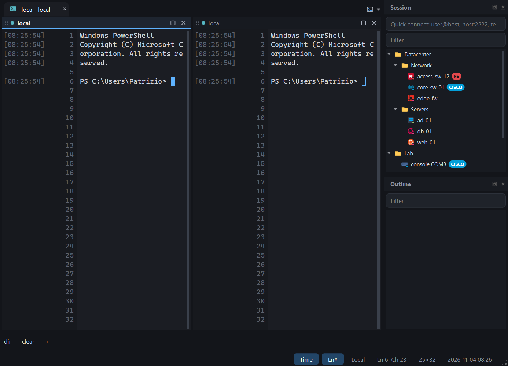

<p align="center"></p>

<h1 align="center">FastShell</h1>

<p align="center">
  Le terminal des admins réseau et système sous Windows : SSH, Telnet, série, bureau à distance et shells locaux,<br>
  dans une seule fenêtre moderne, rapide et sûre.
</p>

<p align="center">
  <a href="https://github.com/cpu-alt/FastShell/releases/latest"></a>
  <a href="https://github.com/cpu-alt/FastShell/actions/workflows/build.yml"></a>
  <a href="LICENSE"></a>
  
</p>

<p align="center"></p>

## Installation

Dans **PowerShell** (pas besoin d'être administrateur) :

```powershell
irm https://raw.githubusercontent.com/cpu-alt/FastShell/main/install.ps1 | iex
```

FastShell s'installe dans `%LOCALAPPDATA%\Programs\FastShell`, avec un raccourci dans le menu
Démarrer et sur le bureau. Le script télécharge la dernière version depuis les
[releases](https://github.com/cpu-alt/FastShell/releases) et vérifie son empreinte SHA-256 avant
d'installer quoi que ce soit.

- **Mettre à jour** : FastShell le propose tout seul (Help → Check for updates), ou relancer la
  même commande.
- **Désinstaller** : *Paramètres Windows → Applications*, ou
  `& "$env:LOCALAPPDATA\Programs\FastShell\install.ps1" -Uninstall`. Vos sessions sont conservées.
- **Sans installer** : télécharger le `.zip` de la dernière release, le décompresser et lancer
  `FastShell.exe`.

## Fonctionnalités

| | |
| --- | --- |
| **SSH comme PuTTY / MobaXterm** | `login as:` et mot de passe tapés dans le terminal, aucune clé utilisée à votre insu, vérification des clés d'hôte, compatibilité automatique avec les vieux switchs (SHA-1/CBC). |
| **Tout dans une fenêtre** | SSH, Telnet, port série (consoles Cisco, FS…), bureau à distance RDP intégré dans un onglet, PowerShell, cmd, Git Bash, WSL. |
| **Écran partagé** | Glisser une session, un onglet ou un panneau sur un terminal pour les mettre côte à côte, avec un aperçu « aimanté » comme Windows. Taper dans tous les panneaux à la fois. |
| **Sessions bien rangées** | Dossiers, couleurs, étiquettes (CISCO, FS…), icône du système (Ubuntu, Windows Server, Fortinet…), utilisateurs partagés, connexion rapide `admin@10.0.0.1`. |
| **Fichiers** | Explorateur SFTP intégré : glisser-déposer depuis l'Explorateur Windows, transferts en parallèle. |
| **Sécurité** | Mots de passe chiffrés par Windows (DPAPI), exports chiffrés en AES-256-GCM, mises à jour vérifiées par SHA-256. Voir [SECURITY.md](SECURITY.md). |
| **Rapide** | Analyseur de terminal en C++20 (~100 Mio/s), rendu limité à la fréquence de l'écran, historique de 20 000 lignes. |
| **Portable** | `FastShell.exe --data-dir D:\mes-sessions` garde tout dans un dossier (clé USB). |

Le guide complet est dans [docs/guide.md](docs/guide.md) : sessions, profils d'équipement,
export / import, écran partagé, port série, RDP, raccourcis clavier.

## Raccourcis essentiels

| Action | Raccourci |
| --- | --- |
| Nouvelle session / nouvel onglet local | Ctrl+Shift+N / Ctrl+Shift+T |
| Couper à droite / en bas | Ctrl+Shift+E / Ctrl+Shift+O |
| Taper dans tous les panneaux | Ctrl+Shift+I |
| Copier / coller | sélectionner à la souris / Ctrl+V ou clic droit |
| Plein écran | Alt+Entrée |

## Contribuer

Compiler, lancer les tests et publier une version : [docs/development.md](docs/development.md).
Signaler une faille de sécurité : [SECURITY.md](SECURITY.md).

## Licence et crédits

FastShell est développé par **Nathan Witz & Patrizio Ventura**, sous licence
[Apache-2.0](LICENSE). Quelques composants tiers sont repris sous leur propre licence : voir
[NOTICE](NOTICE).
