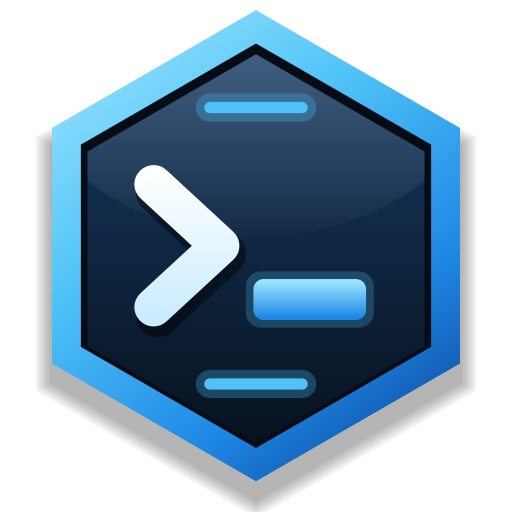
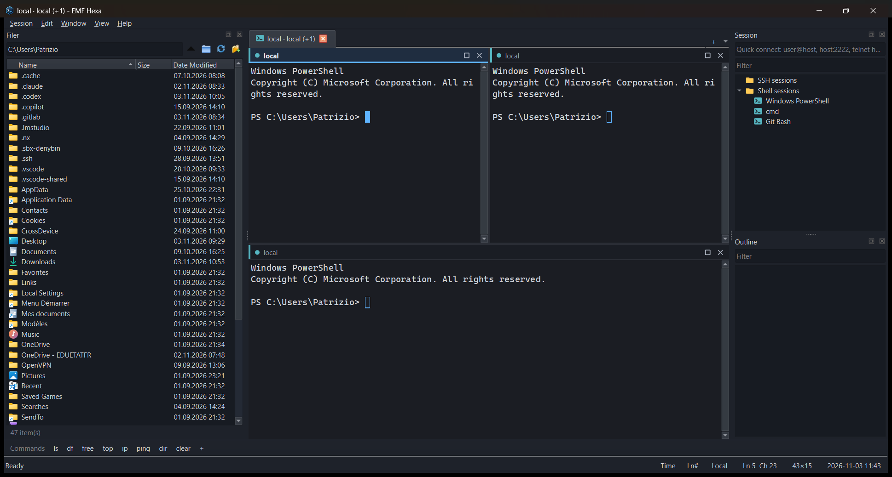

<p align="center"></p>

# EMF Hexa

Terminal SSH, Telnet, série et local d'EMF NET. Il est construit sur une refonte moderne des
composants open source de [WindTerm](https://github.com/kingToolbox/WindTerm) (Apache-2.0).

Le nom et le logo reprennent l'hexagone d'EMF NET : une tuile hexagonale en relief (bord biseauté
bleu éclairé, face en creux avec reflet), avec une invite de terminal `>` et un curseur lumineux.



> WindTerm n'est open source qu'en partie : le dépôt d'origine ne contient pas le code de
> l'application, seulement quelques composants. Ce projet modernise ces composants et
> construit autour d'eux un terminal complet, indépendant du WindTerm officiel.
> L'application s'appelait « WindTerm NG » dans ses premières versions ; ses sessions et
> réglages sont repris automatiquement.

## Ce que fait l'application

### Utilisateurs partagés et profils d'équipement

- **Utilisateurs partagés** (Session → Manage users…, ou « Manage… » dans la boîte de session) :
  on enregistre une fois un compte (nom d'utilisateur, mot de passe chiffré, clé privée), puis
  on le choisit dans « Saved user » pour chaque session SSH. Changer le mot de passe à un seul
  endroit met à jour toutes les sessions qui l'utilisent.
- **Profils d'équipement** (Session → Manage device profiles…) : **Cisco** et **FS** sont fournis,
  et on peut en créer d'autres. Le profil choisi dans « Device » :
  - affiche une étiquette colorée (CISCO, FS…) à côté de la session dans l'arbre, et donne sa
    couleur à l'onglet ;
  - en **série**, remplit les réglages de la console : Cisco 9600 8N1, FS 115200 8N1, sans
    contrôle de flux. Le profil peut aussi envoyer CR LF pour Entrée et ^H pour Retour arrière ;
  - en **SSH**, ne change rien, comme PuTTY.

  Le profil FS suit la documentation FS (S3900, S5850) : 115200 bauds, 8N1, sans contrôle de
  flux. Retour arrière envoie DEL comme PuTTY ; si un équipement ne l'accepte pas, clic droit
  sur l'onglet série → « Backspace sends ^H » pour basculer sans modifier la session.

  Les profils fournis sont modifiables, et vos réglages sont conservés.

### Organiser, partager, ouvrir à plusieurs

- **Couleurs** : clic droit sur un dossier → « Folder color… » ; sur une session → « Icon color… »
  (icône et onglet). « Default … color » revient à la couleur par défaut.
- **Étiquettes personnalisées** : clic droit sur une ou plusieurs sessions → « Tag » pour en
  choisir une, ou « New tag… » pour créer la vôtre (nom, texte de l'étiquette, couleur, réglages
  série facultatifs). CISCO et FS sont fournies.
- **Export / import** : clic droit sur un dossier → « Export this folder… » ou « Import into this
  folder… » ; clic droit dans le vide → tout exporter ou importer. Trois niveaux d'export :
  1. noms et adresses seulement (IP / DNS), sans utilisateur ;
  2. avec les utilisateurs et chemins de clé, sans mot de passe ;
  3. avec les mots de passe, chiffrés en AES-256-GCM par un mot de passe d'export (ils
     restent lisibles sur un autre PC, contrairement au chiffrement Windows).

  L'import n'écrase jamais rien : il ajoute les sessions dans le dossier choisi. Il réutilise un
  utilisateur partagé identique et demande le mot de passe d'export si besoin, sinon il importe
  sans les mots de passe.
- **Plusieurs sessions côte à côte**, plusieurs façons :
  1. **glisser-déposer** une session de l'arbre, **un onglet** (tiré vers le bas hors de la barre
     d'onglets) ou **un panneau** (par sa barre de titre) sur un terminal : un aperçu bleu animé,
     comme l'aimantation des fenêtres Windows, montre où il va se placer (moitié gauche, droite,
     haut ou bas du panneau visé ; au centre d'un panneau du même onglet, les deux s'échangent ;
     contre un bord de l'onglet, il prend tout ce côté). Pendant le glisser, rester une demi-seconde
     sur un autre onglet l'affiche ; lâcher un panneau sur la barre d'onglets le remet dans son
     propre onglet. Le terminal déplacé reste connecté ;
  2. sélectionner plusieurs sessions (Ctrl+clic) → « Open N sessions side by side », ou clic droit
     sur un dossier → « Open all side by side » : grille automatique (2 → côte à côte, 4 → 2×2…) ;
  3. en ligne de commande : `EMFHexa.exe --side-by-side admin@10.0.0.1 admin@10.0.0.2`
     (accepte aussi `telnet hôte`, `rdp hôte`, `"COM3 115200"` et `local`).

  Chaque panneau a sa barre de titre (couleur et nom de la session, □ pour l'agrandir seul dans
  l'onglet, double-clic aussi, × pour le fermer). L'onglet affiche les noms : « sw1 · sw2 (+1) ».
- **Taper dans tous les panneaux** (Window → Type in all panes, Ctrl+Shift+I) : ce que vous tapez
  part vers toutes les sessions de l'onglet, pratique pour envoyer la même commande à plusieurs
  switchs. Un cadre orange et un bandeau dans la barre d'état le signalent.
- **Connexion rapide** : champ en haut du panneau Session. Tapez `admin@10.0.0.1`,
  `switch01:2222`, `telnet 10.0.0.5`, `rdp admin@10.0.0.20` ou `COM3 115200` puis Entrée, sans
  enregistrer de session.
- **Bureau à distance (RDP)** : type de session « Remote desktop (RDP) » (Session → New remote
  desktop, Ctrl+Shift+R, ou le bouton écran de la barre d'outils). Le bureau s'affiche dans un
  onglet, avec le moteur de Bureau à distance de Windows (contrôle `mstscax.dll`, le même que
  mstsc) : utilisateur `DOMAINE\utilisateur` accepté, presse-papiers partagé, le bureau suit la
  taille de l'onglet. Clic droit sur l'onglet : se déconnecter / reconnecter, ou ouvrir la même
  session dans mstsc. Il faut Qt ActiveQt à la compilation (voir plus bas) ; sans lui, l'onglet
  propose d'ouvrir la session dans mstsc.

### Interface

Thème sombre moderne : onglets arrondis reliés au terminal, barre d'outils à icônes (nouvelle
session, onglet local, bureau à distance, coupures, taper partout), menus et champs arrondis,
barres de défilement fines, police Segoe UI Variable, et barre de titre Windows sombre aux
couleurs de l'app (coins arrondis sous Windows 11).

- **Session** (à droite) : sessions enregistrées rangées dans des dossiers et sous-dossiers.
  Clic droit pour créer, modifier, dupliquer, renommer ou supprimer ; glisser-déposer pour
  ranger ; filtre de recherche. Les shells détectés (PowerShell 7, Windows PowerShell, cmd,
  Git Bash, distributions WSL) apparaissent automatiquement dans « Shell sessions ». Chaque
  session peut avoir une couleur d'onglet. Les mots de passe enregistrés sont chiffrés pour
  votre compte Windows (DPAPI), jamais écrits en clair.
- **Outline** (à droite) : liste des commandes tapées dans l'onglet courant. Clic pour revenir
  à la commande dans l'historique, double-clic pour la relancer.
- **Filer** (à gauche) : explorateur de fichiers. Sur un onglet local, il montre le disque ;
  sur un onglet SSH, il montre le serveur en **SFTP** : téléchargement (double-clic), envoi
  (bouton ou glisser-déposer depuis l'Explorateur), renommer, supprimer, nouveau dossier,
  « cd ici » dans le terminal.
- **Transfer** (en bas) : progression des transferts SFTP, qui apparaît automatiquement.
- **Barre de commandes rapides** (en bas) : boutons qui envoient une commande à l'onglet
  courant. Clic droit pour ajouter, modifier, déplacer ou supprimer.
- **Écran partagé (split)** : chaque onglet peut être coupé en plusieurs terminaux, côte à côte
  ou l'un sous l'autre, autant de fois que voulu (coupures imbriquées). Un trait bleu marque le
  panneau actif ; l'Outline, le Filer et la barre d'état le suivent. « Open in split right / down » (clic droit dans
  l'arbre des sessions) ouvre une session enregistrée à côté de l'onglet courant.
- **Marge** du terminal : heure d'écriture de chaque ligne et numéros de ligne, avec les lignes
  de commande mises en évidence. Les boutons « Time » et « Ln# » en bas à droite (ou le menu
  View) les affichent ou les masquent d'un clic, et le choix est mémorisé.
- Barre d'état : état de la connexion, type de session, position du curseur, taille, heure.
- Tous les panneaux sont déplaçables, détachables et masquables ; la disposition est mémorisée.

### Terminal

- Onglets de terminal local : PowerShell 7, Windows PowerShell ou cmd sous Windows (ConPty),
  `$SHELL` sous Linux et macOS.
- Sessions **SSH** : agent, clés de `~/.ssh`, fichier de clé, mot de passe, keyboard-interactive,
  vérification des clés d'hôte via `known_hosts` et lecture de `~/.ssh/config`.
- Compatibilité avec les vieux équipements (switchs, routeurs) : si le serveur ne propose que des
  algorithmes SHA-1/CBC, la connexion est retentée automatiquement avec eux, comme PuTTY ou
  MobaXterm, et un avertissement s'affiche. L'option « Compatibility with old devices » de la
  session autorise en plus `diffie-hellman-group1-sha1` (faible, jamais activé automatiquement).
- Sessions **Telnet** avec une vraie négociation des options (NAWS, TTYPE, ECHO, SGA, BINARY).
- Sessions **série** (port COM, adaptateur USB-série) pour les consoles de switchs et routeurs :
  vitesse, bits de données, parité, bits de stop, contrôle de flux, option CR LF. Les ports
  présents sont listés dans la boîte de session (bouton « Refresh »). Clic droit sur l'onglet →
  « Send BREAK » (récupération de mot de passe, ROMMON). Un adaptateur débranché est signalé et
  Entrée relance la connexion.
- Émulation xterm : 256 couleurs et true color, gras, italique, souligné, barré, écran
  alternatif (vim, htop, less), zones de défilement, caractères de dessin DEC (tmux, mc),
  caractères larges (CJK, emoji), souris (modes 1000/1002/1003/1006), collage sécurisé
  (bracketed paste), titres de fenêtre, rapports de focus.
- Historique de 20 000 lignes, sélection à la souris, double-clic pour sélectionner un mot,
  clic droit pour copier ou coller.

### Raccourcis

| Action | Raccourci |
| --- | --- |
| Nouvel onglet local | Ctrl+Shift+T |
| Nouvelle session (enregistrée ou non) | Ctrl+Shift+N |
| Nouveau bureau à distance (RDP) | Ctrl+Shift+R |
| Dupliquer l'onglet | Ctrl+Shift+D |
| Couper à droite / en bas | Ctrl+Shift+E / Ctrl+Shift+O |
| Aller au panneau voisin | Ctrl+Alt+flèches |
| Fermer le panneau actif (ou l'onglet s'il est seul) | Ctrl+Shift+W |
| Taper dans tous les panneaux de l'onglet | Ctrl+Shift+I |
| Onglet suivant / précédent | Ctrl+Tab / Ctrl+Shift+Tab |
| Copier / Coller | Ctrl+Shift+C / Ctrl+Shift+V (ou clic droit) |
| Remonter dans l'historique | Shift+PgUp / Shift+PgDn / molette |
| Zoom | Ctrl+= / Ctrl+- |
| Plein écran | Alt+Entrée |

## Ce qui a changé par rapport au code d'origine

| Composant | Avant | Maintenant |
| --- | --- | --- |
| Build | Aucun fichier de build, MSVC uniquement | CMake + C++20, GCC, Clang ou MSVC |
| Qt | Qt 5 avec des API privées (`qeffects_p.h`, `QDesktopWidget`) | Qt 6, API publiques seulement |
| ConPty | Le redimensionnement ne marchait jamais (`&&` au lieu de `\|\|` et affectation inversée), `delete` au lieu de `delete[]`, handles fermés deux fois, échec signalé comme réussite, lecture par blocs de 512 octets | Réécrit : lecture par blocs de 64 Kio, un seul signal par rafale de données, arrêt propre sans blocage |
| WinPty | Dépendance externe winpty | Supprimé (ConPty est présent sur tous les Windows supportés) |
| UnixPty | Thread de lecture dédié | Surveillance par la boucle d'événements, sans thread |
| libssh | Copie de **0.9.5**, vulnérable notamment à Terrapin (CVE-2023-48795) | libssh système (0.11+, testé avec 0.12.2) |
| Chiffrement | AES-256-CBC **sans authentification**, IV fixe dérivé du mot de passe | AES-256-GCM, nonce aléatoire à chaque message, PBKDF2-SHA256 avec 600 000 itérations ; l'ancien format reste lisible pour migrer les données |
| CircularBuffer | Mémoire toujours allouée en `qint64` quel que soit `T`, capacité doublée à tort | Vrai stockage de `T`, `std::bit_ceil`, `popBack()` sûr |
| SpinMutex | Attente active avec des `sleep` fixes | Test-and-test-and-set, instruction `pause`, puis `atomic::wait` |
| ScopeGuard | `std::function` (allocation) | Template sans allocation |
| MemoryPointer, ThreadLocal | Ne compilaient qu'avec MSVC ou Boost | Supprimés, remplacés par `std::unique_ptr` et `thread_local` |
| Telnet | Tables de noms seulement | Moteur complet (RFC 854/855/1073/1091/1143) |
| ScrollBar / Splitter / PopupWidget | Qt 5 ; erreurs de position avec un minimum non nul ou sur plusieurs écrans | Qt 6 ; corrigés |

## Performances

L'analyseur de séquences traite environ **108 Mio/s** de sortie de terminal mixte (texte,
couleurs, UTF-8) sur la machine de test (benchmark `Benchmark.ParserThroughput`). Les
principales optimisations :

- le texte ASCII est copié par blocs au lieu d'être traité caractère par caractère ;
- les caractères simples sont écrits directement à l'écran sans passer par le chemin complet ;
- le défilement déplace les lignes sans copier leur contenu ;
- l'affichage est limité à la fréquence de l'écran, et les gros volumes sont traités par tranches
  de 1 Mio pour que l'interface reste réactive ;
- les fonds et le texte de même style sont dessinés en une seule opération ;
- les versions Release sont compilées avec l'optimisation à l'édition de liens (LTO).

## Compiler

### Windows (MSYS2)

```bash
pacman -S --needed mingw-w64-ucrt-x86_64-{gcc,cmake,ninja,qt6-base,qt6-serialport,qt6-activeqt,libssh,gtest}
```

`qt6-activeqt` sert au bureau à distance dans les onglets ; sans lui, la compilation passe et
les sessions RDP s'ouvrent dans mstsc.

```bash
cmake -S . -B build -G Ninja -DCMAKE_BUILD_TYPE=Release
```

```bash
cmake --build build
```

```bash
./build/tests/wtng_tests.exe
```

Pour obtenir un dossier autonome, copier `build/src/EMFHexa.exe` dans un dossier et lancer
`windeployqt6` dessus. Le dossier `dist/` contient déjà une version prête à lancer : `dist/EMFHexa.exe`.

### Linux / macOS

Installer Qt 6, libssh, OpenSSL 3 et GoogleTest avec le gestionnaire de paquets, puis lancer
les mêmes commandes CMake.

## Organisation du code

```
src/core/      buffer circulaire, ScopeGuard, SpinMutex, chiffrement, protocole Telnet
src/terminal/  analyseur VT/xterm, modèle d'écran, largeur des caractères (sans interface)
src/pty/       ConPty (Windows) et pty POSIX
src/net/       SSH (libssh), SFTP pipeliné, Telnet (QTcpSocket)
src/widgets/   ScrollBar, Splitter, PopupWidget (Qt 6)
src/app/       fenêtre, panneaux (Session, Outline, Filer, Transfer), rendu, clavier
tests/         41 tests GoogleTest et un benchmark
```

## Limites connues

- Le code Linux et macOS (`UnixPty`) est écrit mais n'a pas été compilé ni testé : seul Windows l'a été.
- SSH et SFTP n'ont pas encore été testés contre un vrai serveur (aucun serveur SSH disponible
  sur la machine de test).
- Pas encore de pliage des sorties de commande, ni de
  synchronisation automatique du Filer avec le dossier courant du shell.
- Hors Windows, les mots de passe ne sont pas enregistrés (pas encore de trousseau système).
- Les caractères combinants (accents ajoutés après la lettre) sont ignorés ; les caractères
  précomposés comme « é » fonctionnent.
- L'historique n'est pas réorganisé quand on change la largeur de la fenêtre.

## Licence

Apache-2.0, comme les composants d'origine. Basé sur le code de WindTerm (© 2020 WindTerm) et
sur ptyqt pour la partie pty.
